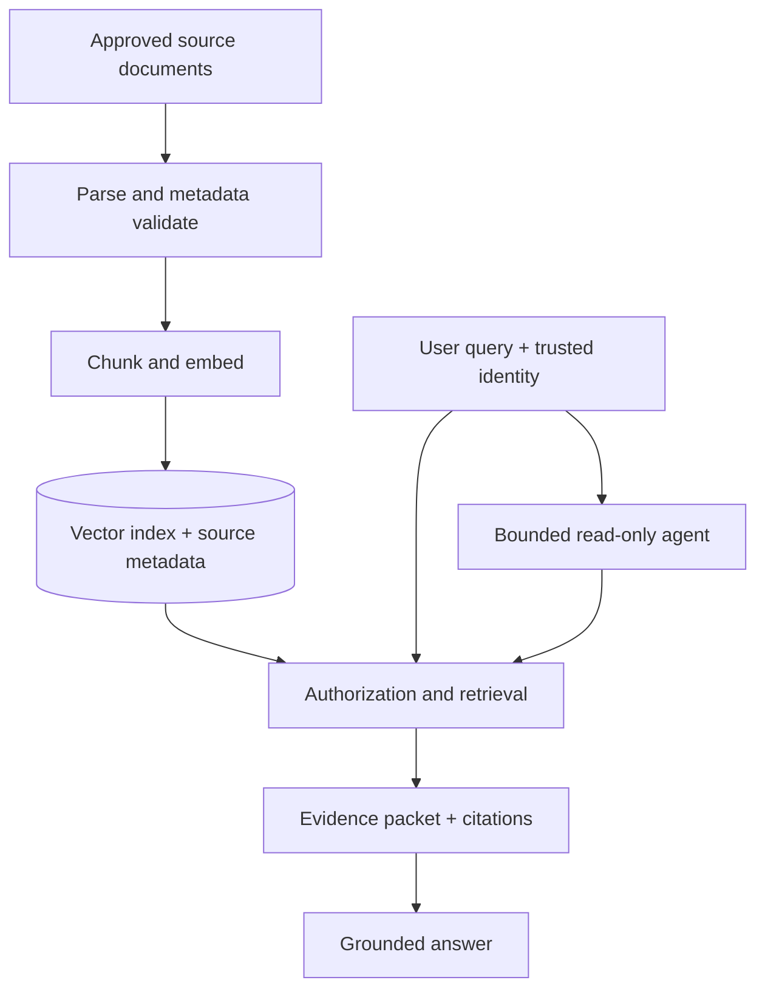

# Enterprise RAG and Agentic RAG: Engineering Workshop


This is a self-contained, GitHub-ready workshop. All documents and organisations in the exercise are **synthetic**. The code is deliberately small enough to inspect during class; the operational controls described in the lessons are required before adapting it to real enterprise data.

## What you will build

1. Load Markdown, TXT, searchable PDF and DOCX knowledge sources with traceable metadata.
2. Compare **eleven** chunking patterns, including structure aware, semantic, parent–child, table aware and code aware strategies.
3. Create normalized embeddings and index them in a persistent local vector database.
4. Retrieve using filtered dense, keyword and hybrid search; assemble cited, token budgeted context.
5. Generate a grounded answer, decline unsupported questions, and validate citation identifiers.
6. Extend this to a **read-only, bounded tool-using agent** that searches runbooks and policy documents as needed.
7. Run offline unit tests and a retrieval evaluation set. Complete a separate assessed assignment.

## 150-minute facilitator schedule

Lesson | | Live activity |
|---|---|---:|---|
[01 — Use case and architecture](lessons/01-enterprise-use-case-and-architecture.md) | | Trace a complex incident question |
[02 — Document loading](lessons/02-document-loading.md) | | Inspect source metadata and retired policies |
[03 — Text chunking strategies](lessons/03-text-chunking.md) || Compare boundaries, overlap and citations |
[04 — Embeddings](lessons/04-embeddings.md) || Inspect nearest neighbours |
[05 — Vector databases](lessons/05-vector-databases.md) | | Index knowledge and enforce metadata filters |
[06 — Similarity search](lessons/06-similarity-and-hybrid-search.md) || Compare cosine, BM25 and RRF |
[07 — Relevant context](lessons/07-context-retrieval.md) | | Build an evidence packet within a token budget |
[08 — Grounded answers](lessons/08-grounded-answer-generation.md) || Answer with citations and abstention |
[09 — Agentic RAG](lessons/09-agentic-rag.md) || Multi-tool incident investigation |
[10 — Evaluation and enterprise hardening](lessons/10-evaluation-security-and-operations.md) || Run tests, examine failure modes |

The [Exercise](exercises/PARTICIPANT_EXERCISE.md) is a **post-session submission**, estimated at 2–4 additional hours; it is not counted inside this session.

## Quick start

Requires **Python 3.11+**; a CPU is enough for the small demonstration model. Expect the first sentence-transformer run to download a model from Hugging Face; verify your organization's model licence, download and data residency policies. No enterprise data is included.

```bash
python -m venv .venv
source .venv/bin/activate                 # Windows: .venv\Scripts\activate
python -m pip install -r requirements.txt
python -m unittest discover -s tests -v  # standard-library tests, no credentials
python -m src.cli load
python -m src.cli chunk --strategy headings
python -m src.cli embed
python -m src.cli index
python -m src.cli search --mode hybrid --role engineer --question "How do we handle payment API 5xx caused by database pool exhaustion?"
python -m src.cli context --role engineer --question "What evidence and approvals are needed before an emergency rollback?"
python -m src.cli evaluate --mode hybrid
```

**Optional LLM-backed generation and agent:** configure an approved model and an API key (never commit credentials).

```bash
export OPENAI_API_KEY="your-approved-key"
export OPENAI_MODEL="gpt-4.1-mini"       # override with a model available to your account
python -m src.cli answer --role engineer --question "What should I check and who approves emergency rollback for a P1 payments incident?"
python -m src.cli agent --role engineer --question "Payments API is returning 5xx due to DB pool saturation. Which runbook steps and change approvals apply?"
```

`load`, `chunk` and unit tests run without external services. Embedding/index/search require the local embedding model on first use; answer/agent require an approved hosted model and incur API charges. The examples **do not** write to ITSM, change systems or production infrastructure. Neither an API key nor real incident logs are needed for the workshop's first seven modules.

## Repository map

```text
lessons/             10 independent, sequential Markdown lessons
exercises/           participant assignment, rubric and submission specification
data/catalog.json    trusted synthetic source inventory with version/ACL metadata
data/knowledge/      versioned synthetic runbooks, policies and reviews
data/eval.jsonl      retrieval evaluation cases
data/adversarial/    non-indexed injection test for the assignment
src/                runnable Python examples behind every lesson
tests/              offline test suite
references.md       verified vendor, standards and security documentation
requirements.txt    Python dependencies
```

## Architecture and deliberate boundaries



- **Authorization applies inside retrieval.** The CLI `--role` is a teaching simulation, not authentication; production roles and tenant IDs must come from verified identity claims, not user-controlled arguments.
- **Active version only.** Retired documents are omitted during indexing; stale embeddings must also be removed during real ingestion updates.
- **No “magic” similarity threshold.** Scores are not calibrated probabilities. Tune coverage/abstention using a labelled evaluation set.
- **Grounding is not a security boundary.** Retrieved content is untrusted, citations are evidence pointers rather than proof of correctness, and prompt injection remains possible.
- **Production changes:** secure upstream connectors, scanned/OCR/layout-aware parsing, encrypted infrastructure, tenant isolation, audit trails, redaction, service accounts, observability, rate limits, content safety and review gates. See Lesson 10.

## Outcomes to assess

Participants should be able to explain how document versions and ACLs survive ingestion; justify a chunking choice with failure cases; distinguish distance from similarity; show recall@k and citation evidence; implement abstention; and describe exactly where agentic tool use adds value and operational risk.

All code and source attributions are explained in [references.md](references.md). This is a demonstration reference implementation, **not a certified production service**.

**Public GitHub release note:** choose and add an appropriate licence, confirm approval to publish materials and dependency/model licences, and run your organisation's security/dependency scanner before pushing to a public repository.
