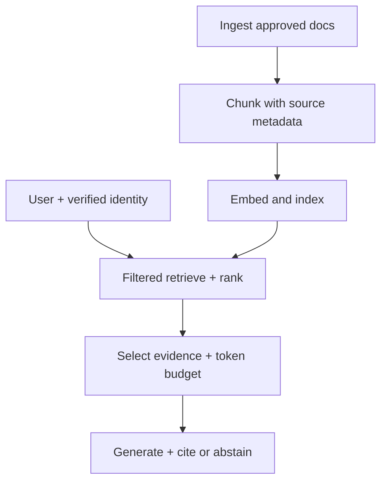

# 01 — Enterprise use case and RAG architecture

**Time: 10 minutes** · **Objective:** Explain what enterprise RAG solves, trace the request path, and distinguish baseline RAG from Agentic RAG.

## The case: Northstar Payments incident knowledge copilot

At 09:15, the Payments API records high HTTP 5xx errors and connection-pool saturation after a configuration release. A support engineer asks:

> “What should we verify before mitigating the pool exhaustion, who can approve emergency rollback, and how long must we observe recovery?”

The answer spans *three kinds of evidence*: technical runbooks, policy/approval rules and recovery thresholds. A standalone language model may invent approval authority or retrieve an obsolete instruction. We need approved documents and source-traceable answers.

The training catalog in [`../data/catalog.json`](../data/catalog.json) contains synthetic runbooks, policies, a postmortem, one **retired** runbook and one **restricted** security document. None is real company material.

## Baseline RAG: fixed pipeline



At ingestion time we process documents once per version. At query time we process each user request and apply authorization **before** ranking or building a prompt. The model should never see documents that the user cannot access.

## Agentic RAG: deliberate, bounded retrieval decisions

An agent can choose a sequence of **read-only** tools: `search_runbook`, `search_policy`, `search_postmortem`. For this incident it may search a DB runbook, then emergency-change policy, then a historical review. It is useful for ambiguous, multi-hop questions. It is unnecessary for straightforward one-document fact lookup; multiple model/tool rounds add latency, cost and failure modes.

| Decision | Deterministic RAG | Agentic RAG |
|---|---|---|
| Retrieval path | Pre-set: embed → search → answer | Model can select/repeat tools |
| Transparency | Easier to reproduce | Requires tool-call traces |
| Latency/cost | Predictable | Variable; cap rounds/calls |
| Production actions | None in this workshop | None; read-only tools only |
| Good fit | “What is our P1 acknowledgement target?” | “What happened, what should we verify, and which approvals govern rollback?” |

## Inspect the case with Python

```bash
python -m src.cli load
```

The catalog metadata is part of the system design, not an afterthought:

```python
from src.loading import load_catalog

documents = load_catalog()
for doc in documents:
    meta = doc.metadata
    print(meta["doc_id"], meta["version"], meta["status"], meta["allowed_roles"])
```

The result should include `RUN-PAY-OLD` as **retired**, and `SEC-FRAUD-009` accessible only to `security`. These records may be *loaded* for audit, but retired content must not be indexed as active knowledge.

## Teaching checkpoint

Ask participants: “Which component decides whether someone is allowed to view a runbook?” Correct answer: a trusted application identity and retrieval/underlying-store policy, **not** the language model, user-provided role text, embedding similarity or a post-generation redaction prompt.

**Next:** [02 — Document loading](02-document-loading.md).
