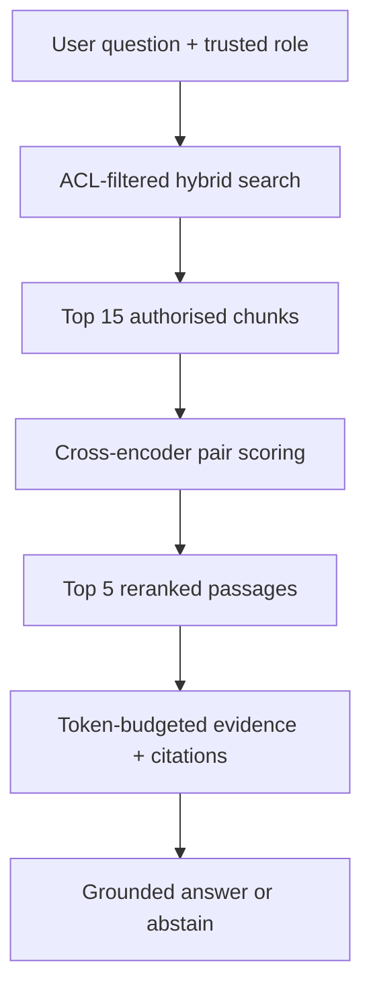

# 06b — Reranking in enterprise RAG and Agentic RAG

**Time:** 8 minutes within Module 06's existing 15-minute slot (plus an optional 10–15-minute hands-on extension) · **Audience:** RAG / search engineers · **Use case:** Northstar Payments incident-response copilot

**Outcome:** Retrieve a broad, access-controlled candidate set and then reorder it with a local cross-encoder so that the final evidence packet favours passages directly relevant to the user's question.

## 1. Why reranking is necessary

The first retrieval stage has a **recall-oriented** job: find a broad pool of potentially relevant passages using vector similarity, keyword matching or hybrid search. A dense retriever embeds questions and documents independently; this is efficient but may not recognise nuanced distinctions such as:

- “Can the engineer roll back immediately?” versus “Who **must approve** rollback before execution?”
- “Database utilization crossed 90%” versus “Restart the database whenever utilization is high.”
- “A historical incident used a rollback” versus “The **current policy** permits this action.”

A **cross-encoder reranker** reads each `(question, candidate passage)` pair jointly and returns a relevance score. It compares the *question with the passage*, rather than comparing independent embedding vectors. It is usually more computationally expensive per candidate, so we rerank only the initial top N results. This two-stage approach is documented by the Sentence Transformers maintainers. [Source](https://www.sbert.net/docs/cross_encoder/usage/usage.html).

### Two-stage design



The **authorization filter happens before reranking**. A cross-encoder is a relevance model, never an access-control mechanism. Reranking also cannot recover a relevant document that first-stage retrieval failed to include.

## 2. Bi-encoder versus cross-encoder

| Feature | First-stage bi-encoder | Cross-encoder reranker |
|---|---|---|
| Inputs | Query and passage encoded separately | Joint query–passage pair |
| Output | Reusable vectors and cosine/dot score | One relevance score per pair |
| Search role | Search entire index efficiently | Reorder a small candidate pool |
| Cost at query time | Embedding once + ANN lookup | Model inference for each candidate |
| Good for | Broad recall, semantic match | Fine-grained relevance, query-specific ranking |
| Cannot guarantee | Correctness/authorization | Correctness/authorization or calibrated confidence |

For the training runtime we use the maintainers' example model, `cross-encoder/ms-marco-MiniLM-L6-v2`. It is a useful small English passage reranker, **not a pre-certified model for enterprise incidents, multilingual queries or regulatory evidence**. Treat outputs as relative ranking scores; even a sigmoid-transformed score is not automatically a validated probability of factual truth. [CrossEncoder API](https://www.sbert.net/docs/package_reference/cross_encoder/model.html).

## 3. Working Python implementation

The complete reusable function is in [`../src/reranking.py`](../src/reranking.py). It validates the role and each candidate's tenant, status and ACL metadata, removes duplicates, batches cross-encoder inference, checks score validity, and returns `SearchHit` objects with original source metadata intact.

The essential scoring operation is:

```python
from sentence_transformers import CrossEncoder

model = CrossEncoder(
    "cross-encoder/ms-marco-MiniLM-L6-v2",
    max_length=512,
    trust_remote_code=False,
)

question = "Who must approve an emergency rollback during a P1 incident?"
passages = [
    "Rollback requires incident commander and independent on-call change approver.",
    "The connection pool utilization exceeded 90% for five minutes.",
    "The payments service runs daily data-quality checks.",
]

pairs = [(question, passage) for passage in passages]
scores = model.predict(pairs, batch_size=16)
for passage, score in sorted(zip(passages, scores), key=lambda row: -float(row[1])):
    print(round(float(score), 4), passage)
```

### Full end-to-end script: retrieval → reranking → evidence

Copy this code into `reranking_demo.py` **at the repository root** if you want a single-file executable example. It uses the reusable workshop modules and synthetic dataset; first run `python -m src.cli index`.

```python
"""reranking_demo.py — standalone demo using the enterprise RAG workshop."""
from src.context import build_packet
from src.embeddings import LocalEncoder
from src.reranking import load_cross_encoder, rerank_hits
from src.retrieval import hybrid
from src.vector_store import collection


def main():
    question = (
        "During P1 payments DB pool exhaustion, who approves emergency "
        "rollback and what recovery checks are required?"
    )
    role = "engineer"  # Demo only; derive from verified SSO claims in production.
    encoder = LocalEncoder()
    store = collection()

    # Step 1: broad, authorized retrieval (recall-oriented).
    candidates = hybrid(store, encoder, question, role=role, k=15)
    print("\nINITIAL TOP 5:")
    for index, hit in enumerate(candidates[:5], 1):
        print(index, hit.metadata["doc_id"], round(hit.score, 4))

    # Step 2: jointly score each question–passage pair (precision-oriented).
    reranker = load_cross_encoder()
    top_hits = rerank_hits(question, candidates, top_k=5, role=role,
                           scorer=reranker, batch_size=16)
    print("\nRERANKED TOP 5:")
    for index, hit in enumerate(top_hits, 1):
        print(index, hit.metadata["doc_id"], round(hit.score, 4),
              hit.text[:75].replace("\n", " "))

    # Step 3: only authorized, reranked hits enter the evidence packet.
    packet = build_packet(top_hits, max_tokens=1200)
    print("\nGROUNDED EVIDENCE:\n", packet.text)
    print("\nSource IDs:", list(packet.sources))


if __name__ == "__main__":
    main()
```

You can also run the integrated CLI without copying any code:

```bash
python -m src.cli index
python -m src.cli search --mode hybrid --role engineer \
  --question "Who approves P1 rollback after database pool saturation?" --k 5
python -m src.cli search --mode hybrid --rerank --candidate-k 15 \
  --role engineer --question "Who approves P1 rollback after database pool saturation?" --k 5
python -m src.cli context --mode hybrid --rerank --candidate-k 15 \
  --role engineer --question "Who approves rollback and how do we verify recovery?"
```

No external generation API is necessary for these commands. The **first** reranking invocation downloads model weights; check software licences and your organisation's network/model-governance policies first.

## 4. Reranking in Agentic RAG

An agent might separately search `runbook`, `policy`, and `postmortem` tools. Apply the same pattern **inside each authorised tool**:

```python
from src.retrieval import hybrid
from src.reranking import load_cross_encoder, rerank_hits
from src.embeddings import LocalEncoder
from src.vector_store import collection

# `tool_query` and `document_type` originate from a validated, bounded agent
# tool request. `trusted_role` comes from the application identity service.
tool_query = "emergency production rollback approval"
trusted_role = "engineer"  # Synthetic training role.
document_type = "policy"

candidates = hybrid(
    collection(), LocalEncoder(), tool_query,
    role=trusted_role, doc_type=document_type, k=12,
)
evidence = rerank_hits(
    tool_query, candidates, role=trusted_role, top_k=4,
    scorer=load_cross_encoder(),
)
```

Use `python -m src.cli agent --rerank --role engineer --question "..."` to demonstrate this after setting an approved `OPENAI_API_KEY` and `OPENAI_MODEL`. Reranking only changes which authorised passages the agent receives; it does **not** grant tool permissions, lift the approval gate or allow autonomous rollback execution.

## 5. Compare reranking objectively

The existing labelled retrieval set lets you compare two variants using the **same questions, gold source IDs and roles**:

```bash
python -m src.cli evaluate --mode hybrid --k 5
python -m src.cli evaluate --mode hybrid --rerank --candidate-k 15 --k 5
```

Record `mean_hit_at_k`, `mean_doc_recall_at_k`, `mrr_at_k`, latency per question and any access-control failures. The demo set is too small to claim production superiority. A full evaluation should additionally check ranking quality (nDCG@k), citation completeness, answer faithfulness and p50/p95 latency on a representative corpus.

| Design choice | Recommended starting experiment | What to measure |
|---|---|---|
| Candidate count | Retrieve 10, 15 and 30 candidates | Recall ceiling vs cost/latency |
| Final evidence count | Retain 3, 5 and 8 chunks | Claim coverage and token use |
| Reranker model | Small approved cross-encoder vs stronger approved model | Domain/language accuracy and inference speed |
| Passage length | Compare 300–500 token windows with shorter ones | Truncation, lost qualifiers, latency |
| Retrieval basis | Dense-only vs hybrid prior to reranking | Whether exact IDs survive candidate generation |

## 6. Failure modes engineers must understand

1. **No relevant candidate:** reranking cannot invent or retrieve absent evidence; improve first-stage recall.
2. **Permission violation:** never send forbidden chunks to the reranker; the provided function fails closed on forbidden/stale metadata.
3. **Long passages:** the example cross-encoder is capped at 512 tokens for the combined pair; key evidence beyond the model window can be ignored.
4. **Score confusion:** reranker scores cannot be compared numerically to cosine similarity or BM25 scores, and a high relevance score is not a truth guarantee.
5. **Version confusion:** status filtering and supersession are policy decisions, not embedding/relevance decisions.
6. **Latency and cost:** more candidates mean more inference; batch, cache appropriately, monitor p95, and consider smaller local/quantized models.
7. **Prompt injection:** suspicious retrieved text remains untrusted even when the reranker marks it highly relevant.

## 7. Participant checkpoint

Ask learners to explain why `POL-CHG-010` should rank prominently for **“Who approves the rollback?”** even though `RUN-DB-201` might rank highly for **“What caused connection saturation?”**. Require an evidence citation supporting the approval requirement; ranking alone is not the answer.

**Independent exercise:** compare `--candidate-k 10`, `15`, and `30`; report MRR@5, end-to-end latency and any change in the policy document's rank. Submit the results and a paragraph explaining whether reranking earned its additional compute cost on the case.

**Official references:** [Sentence Transformers CrossEncoder API](https://www.sbert.net/docs/package_reference/cross_encoder/model.html), [reranking examples](https://www.sbert.net/examples/cross_encoder/training/ms_marco/README.html), [pretrained reranker models](https://www.sbert.net/docs/cross_encoder/pretrained_models.html).
