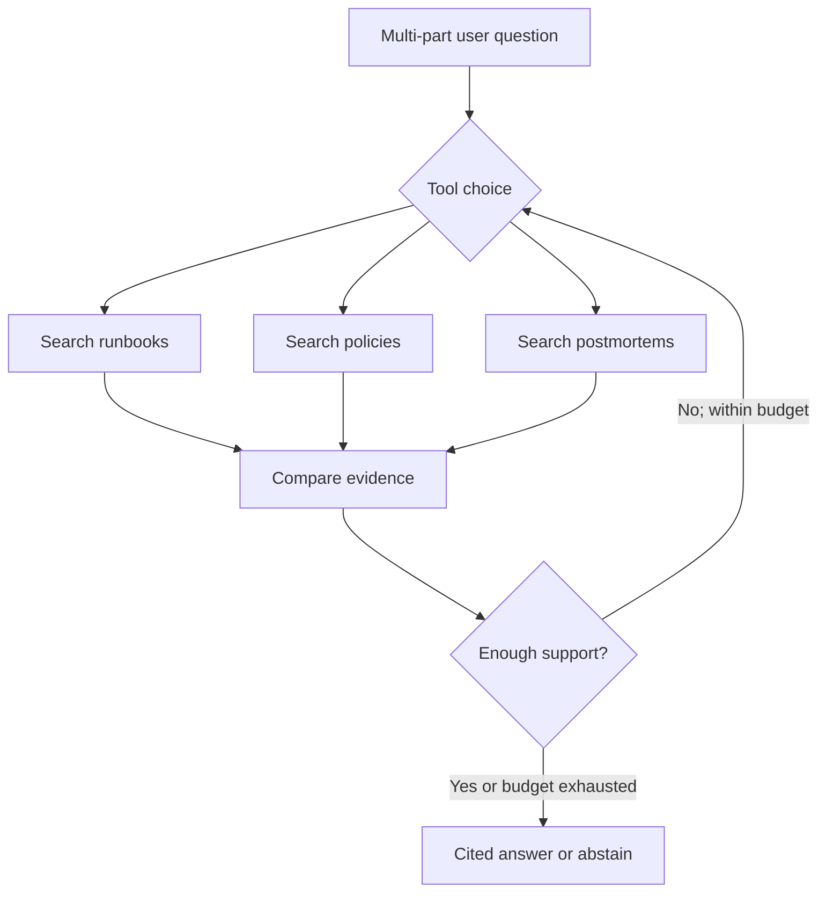

# 09 — Agentic RAG: tool choice, decomposition and bounded retrieval

**Time: 20 minutes** · **Objective:** Implement an agent that chooses among retrieval tools while remaining observable, read-only and constrained by application-owned authorization.

## What changes compared with a fixed RAG chain?

Baseline RAG runs a preselected pipeline once. An Agentic RAG system can choose **which source families to search**, issue focused follow-up queries, gather missing evidence, and stop when it has enough context. The *model chooses the information path; code controls actual capability and access*.

For the scenario “5xx after a pool configuration change; what diagnostics and approvals apply?” a sensible path is:



The choices and source identifiers should be logged. Repeated loops, open-ended web access and write-capable tools are **not** needed for this exercise.

## Tools are narrow and typed

[`../src/agent.py`](../src/agent.py) declares three functions: `search_runbook`, `search_policy`, `search_postmortem`. Each accepts only a focused query string; the application fixes `role`, `tenant`, `k`, allowed document types and maximum call count.

```python
TOOL = {
    "type": "function",
    "name": "search_policy",
    "description": "Search authorised policy documents",
    "parameters": {
        "type": "object",
        "properties": {"query": {"type": "string"}},
        "required": ["query"],
        "additionalProperties": False,
    },
    "strict": True,
}
```

The runtime handles the tool call response, **validates the requested tool and argument**, dispatches an authorized hybrid retrieval, then returns passages labelled `[S1]`, `[S2]`, etc. to the model. The tool cannot execute SQL statements or deployments.

Core response/tool loop pattern:

```python
import json
from openai import OpenAI

client = OpenAI()
messages = [{"role": "user", "content": "Which rollback approvals apply?"}]
response = client.responses.create(model="gpt-4.1-mini", input=messages,
                                   tools=[TOOL], store=False)
messages.extend(response.output)
for item in response.output:
    if item.type == "function_call":
        args = json.loads(item.arguments)
        # Dispatch through a strict code-owned allowlist, not eval() or shell.
        approved_output = {"passages": [], "note": "illustrative empty tool result"}
        messages.append({"type": "function_call_output", "call_id": item.call_id,
                         "output": json.dumps(approved_output)})
```

The full project code substitutes real, filtered retrieval for the illustrative empty result and continues the model loop for at most **3 rounds / 5 tool calls**. It does not expose system prompts, credentials or unrestricted connector APIs to a document.

## Run the full agent

```bash
export OPENAI_API_KEY="your-approved-key"
export OPENAI_MODEL="gpt-4.1-mini"
python -m src.cli agent --role engineer \
  --question "Payments API has P1 5xx due to database pool saturation after a configuration change. What should be checked, what approvals are required for rollback, and how is recovery verified?"
```

Inspect the `AUDIT` JSON: tool name, focused query, returned source IDs and final citation-ID check. Model outputs and tool order are nondeterministic; participants should explain **why** each chosen search was relevant and identify what evidence was missed.

## Five enterprise control points

1. **Least privilege:** tools in this exercise are retrieval-only. Human approval is mandatory before any future ITSM/deployment write action.
2. **Identity is external to the model:** the signed-in role and tenant are established by the application, not the prompt or tool arguments.
3. **Limits:** maximum tool rounds, call count, query length, output length, cost and latency. Set budget alerts and failure handling.
4. **Untrusted outputs:** retrieved runbooks, third-party tickets and postmortems may contain malicious instructions. Never promote them to system authority.
5. **Observability:** audit tool calls, collection version, retrieved document/version IDs, abstention and human overrides without logging sensitive raw data unnecessarily.

## Where an agent helps—and where not

Agentic search is valuable for decomposition, adaptive source selection and evidence reconciliation. It **does not** remove the need for high-recall retrieval, reranking, source/version authority, citation checks or offline evaluation. Before a workflow acquires write tools, introduce explicit approvals, idempotency keys, constrained scopes, compensation/recovery and independent authorization.

**Next:** [10 — Evaluation, security and operations](10-evaluation-security-and-operations.md). [Function calling references](../references.md).
